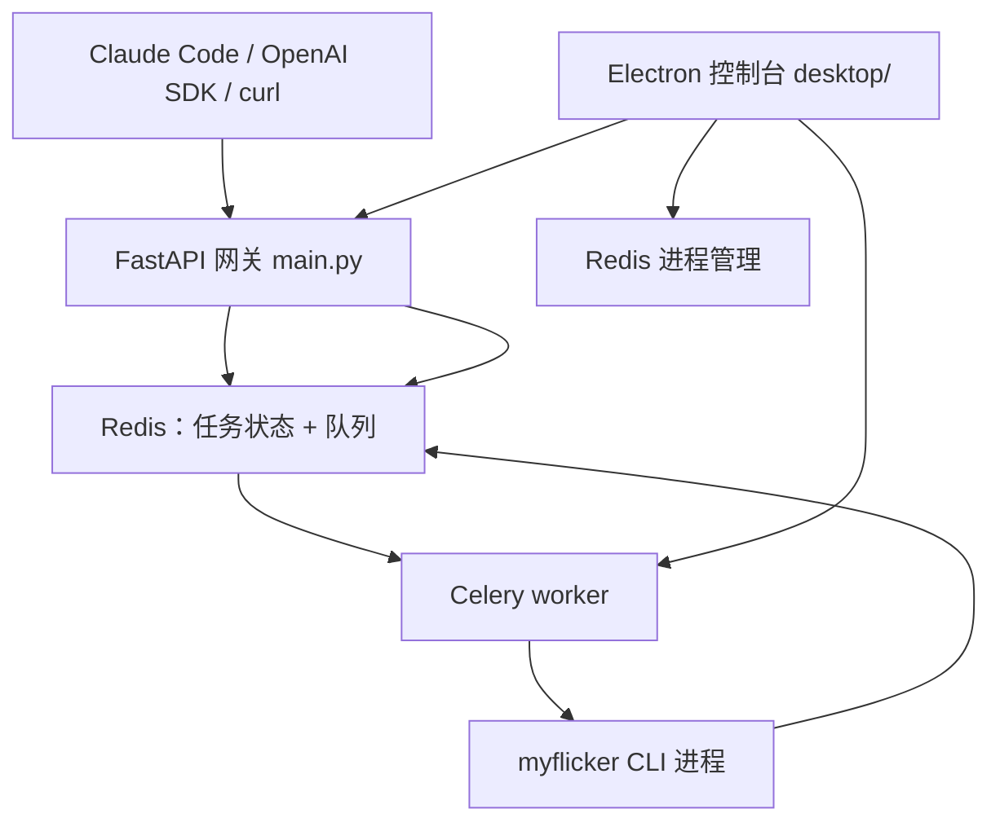

# 从零开始学习 cli2api-myflicker

这份教程面向**零基础**读者：假定你写过很少代码，但对 HTTP、Python、Redis、Electron 都还不熟。
目标不是背 API，而是让你能回答三个问题：

1. 这个项目由哪几个进程组成，它们怎么协作？
2. 一条请求从 HTTP 进入到 CLI 输出，中间经过了哪些代码？
3. 出问题时，应该先看哪个文件、哪条日志？

> 建议阅读方式：每章先看「本章目标」，再读讲解，最后照着「动手」敲一遍命令并回答「自检」。
> 不要一次读完；按章节逐个验收，效果最好。

---

## 目录

- [第 0 章 这份教程怎么用](#第-0-章-这份教程怎么用)
- [第 1 章 先建立心智模型](#第-1-章-先建立心智模型)
- [第 2 章 项目全景](#第-2-章-项目全景)
- [第 3 章 零基础预备知识](#第-3-章-零基础预备知识)
- [第 4 章 最短路径跑起来](#第-4-章-最短路径跑起来)
- [第 5 章 代码地图与阅读顺序](#第-5-章-代码地图与阅读顺序)
- [第 6 章 网关 main.py](#第-6-章-网关-mainpy)
- [第 7 章 任务执行 celery_tasks.py](#第-7-章-任务执行-celery_taskspy)
- [第 8 章 多租户与隔离 identity.py](#第-8-章-多租户与隔离-identitypy)
- [第 9 章 OpenAI 兼容面](#第-9-章-openai-兼容面)
- [第 10 章 Anthropic / Claude Code 兼容面](#第-10-章-anthropic--claude-code-兼容面)
- [第 11 章 桌面控制台 desktop/](#第-11-章-桌面控制台-desktop)
- [第 12 章 日志与排障](#第-12-章-日志与排障)
- [第 13 章 测试与隔离纪律](#第-13-章-测试与隔离纪律)
- [第 14 章 打包与安装](#第-14-章-打包与安装)
- [第 15 章 OpenSpec 规格驱动](#第-15-章-openspec-规格驱动)
- [第 16 章 练习与验收](#第-16-章-练习与验收)
- [附录 A 配置速查](#附录-a-配置速查)
- [附录 B 常见问题](#附录-b-常见问题)
- [附录 C 术语表](#附录-c-术语表)
- [附录 D 30 天学习计划](#附录-d-30-天学习计划)

---

## 第 0 章 这份教程怎么用

**本章目标**：知道学习顺序、需要准备什么、每一步怎么算“学会了”。

### 你需要准备

- 一台 macOS / Linux 电脑（Windows 也能跑后端，桌面端差异另行说明）
- Python 3.10+（仓库实际使用 3.13）
- Redis（macOS：`brew install redis`）
- Node.js 18+（只跑后端不需要；跑桌面端需要）
- 一个终端（Terminal / iTerm2 / zsh / bash 均可）

### 三条学习原则

1. **先跑通，再理解**。第 4 章会用 `mock_myflicker.sh` 代替真实 CLI，让你不接触私有工具也能看到完整链路。
2. **每章只读一个文件**。这个项目的文件职责划分很清楚，不要一口气读十个文件。
3. **所有实验用隔离端口和数据目录**。不要动正在使用的服务和配置，仓库根目录的 `AGENTS.md` 第 0 节就是这条红线。

### “学会了”的标准

每章末尾都有「自检」。能不看文档回答出来，就算过关；回答不出来就回到对应小节。

---

## 第 1 章 先建立心智模型

**本章目标**：理解这个项目最核心的四个概念：HTTP API、进程、队列、工作目录。

### 1.1 这个项目到底在干什么

一句话：**把本机一个只能在终端里用的私有 CLI（`myflicker`），包装成 HTTP API。**

原先是这样的：

```bash
myflicker -q "帮我分析这个目录"
# 在终端里等它输出
```

包装后变成：

```bash
curl -X POST http://127.0.0.1:8000/api/myflicker/submit \
  -H "X-API-Key: <key>" -H "Content-Type: application/json" \
  -d '{"args":["-q","帮我分析这个目录"]}'
# 立刻返回一个 task_id；再轮询 /result/<task_id> 拿输出
```

好处：任何能发 HTTP 的程序（OpenAI SDK、Claude Code、LangChain、你自己的脚本）都能用它。

### 1.2 为什么不能直接“HTTP 进来就执行 CLI”

两个硬约束：

1. **CLI 很慢**：一次可能跑几十秒到几分钟。HTTP 请求一直挂着容易超时、断线。
2. **CLI 有按目录的互斥锁**：同一个工作目录同时只能跑一个 `myflicker` 进程。

所以项目引入了「异步任务 + 队列」：

```
HTTP 请求 --> 立刻创建任务，返回 task_id
                 |
                 v
             Redis 队列（每个 key 一条）
                 |
                 v
             Celery worker（并发=1）
                 |
                 v
         真正 spawn myflicker 进程
```

HTTP 层只负责“收请求、排队、查状态”，永远不亲自执行 CLI。这是读代码时最重要的分工。

### 1.3 四个关键词

| 词 | 在本项目里的含义 |
| --- | --- |
| API Key | 调用方身份。一个 key 对应一个 label、一条队列、一个工作区 |
| task_id | 一次 CLI 执行的唯一编号，32 位十六进制 |
| worker | Celery 进程，真正拉起 `myflicker` 的地方；`--concurrency=1` |
| cwd | 工作目录（current working directory）。CLI 在哪个目录跑，决定它能读写哪些文件、续哪个会话 |

### 1.4 一个必须记住的约束

**同目录串行、跨目录并行。**

- 同一个工作目录：只能有一个 `myflicker` 进程，所以任务排队。
- 不同工作目录：可以同时跑。
- 所以执行拓扑是「每个 API key 一条串行通道，不同用户之间并行」。

后面的代码、规格、桌面端状态展示，全部围绕这条约束设计。

### 自检

1. 为什么 HTTP 请求不直接等待 CLI 结束？
2. 两个不同 API key 的请求能不能同时执行？同一个 key 的两个请求呢？
3. `cwd` 影响哪两件事？

---

## 第 2 章 项目全景

**本章目标**：知道仓库里每个顶层文件/目录的职责。

### 2.1 角色与数据流



### 2.2 顶层文件表

| 路径 | 作用 | 初学优先级 |
| --- | --- | --- |
| `main.py` | HTTP 网关：私有接口 `/api/myflicker/*`、鉴权、中间件、健康检查 | 高 |
| `openai_api.py` | OpenAI 兼容接口 `/v1/chat/completions`、`/v1/models` | 高 |
| `anthropic_api.py` | Anthropic / Claude Code 接口 `/v1/messages`、`/v1/messages/count_tokens` | 高 |
| `celery_tasks.py` | 任务执行层：状态、日志、spawn CLI、超时、流式输出 | 最高 |
| `worker_supervisor.py` | 根据 `API_KEYS` 自动为每个 label 启动一个 worker | 中 |
| `identity.py` | API key 解析、label、workspace、沙箱 | 高 |
| `test_client.py` | 命令行测试客户端（私有接口 + `messages` 子命令） | 中 |
| `mock_myflicker.sh` | 假 CLI，用于不接触真实工具时验证链路 | 高（第 4 章） |
| `requirements.txt` | Python 依赖 | 低 |
| `.env.example` | 配置模板 | 高 |
| `desktop/` | Electron + React 桌面控制台 | 中后期 |
| `openspec/` | 规格与变更记录（规格驱动开发） | 中后期 |
| `logs/` | 运行日志（默认） | 中 |

### 2.3 两条调用链

**私有任务接口**

```
POST /api/myflicker/submit  -> 202 {task_id}
GET  /api/myflicker/result/{task_id} -> pending | running | success | failure | canceled
```

**OpenAI / Anthropic 兼容接口**

```
POST /v1/chat/completions -> 同步等待或 SSE 流式
POST /v1/messages         -> 同步等待或 Anthropic SSE 流式
```

兼容接口在内部仍然会转成一次任务提交，只是帮你把“提交 + 轮询 + 拼装响应”都做完了。

### 自检

1. 哪个文件负责真正拉起 `myflicker`？
2. 私有接口和兼容接口最终都落到哪里？
3. `worker_supervisor.py` 为什么不自己执行 CLI？

---

## 第 3 章 零基础预备知识

**本章目标**：补齐读代码需要的六个最小知识点，够用即可，不追求系统学习。

### 3.1 Python 虚拟环境与依赖

```bash
python3 -m venv .venv
source .venv/bin/activate
pip install -r requirements.txt
```

- `venv` = 每个项目独立的一套 Python 包，避免污染系统 Python。
- 之后所有 Python 命令都应先 `source .venv/bin/activate`，或用 `.venv/bin/python` 绝对路径。

### 3.2 HTTP 与 JSON

HTTP 请求由「方法 + 路径 + 头 + 体」组成：

```http
POST /api/myflicker/submit HTTP/1.1
X-API-Key: abc
Content-Type: application/json

{"args": ["-q", "hello"]}
```

- 方法：GET 查询，POST 提交。
- 状态码：2xx 成功，4xx 调用方问题，5xx 服务端问题。
- JSON：Python 里是 `dict` 和 `list` 的文本表示。

### 3.3 FastAPI 最小知识

```python
from fastapi import FastAPI
app = FastAPI()

@app.get("/ping")
def ping():
    return {"ok": True}
```

- `@app.get/post` 是路由装饰器。
- 函数返回值会被自动转成 JSON。
- 项目用 `Header()`、`Depends()` 读取请求头与做鉴权。

### 3.4 Redis 最小知识

Redis 是内存键值数据库。本项目用它存三样东西：

1. 任务状态：`SET myflicker:task:<task_id> '<json>' EX 86400`
2. 任务队列：Celery 的 broker（本质是 Redis list）
3. 流式输出缓冲：stdout 分块追加，供 SSE 读取

常用命令：

```bash
redis-cli ping
redis-cli -n 0 keys 'myflicker:task:*' | head
```

> `-n` 是库编号。项目里 Redis、broker、result backend 可以配到不同库，避免互相干扰。

### 3.5 Celery 最小知识

Celery 是 Python 的分布式任务队列。

```python
@celery_app.task
def add(a, b):
    return a + b

add.apply_async(kwargs={"a": 1, "b": 2}, queue="myqueue")
```

- 生产者：网关调用 `apply_async` 投递任务。
- 消费者：worker 从指定队列取任务并执行。
- 本项目强制 `--concurrency=1`，因为 CLI 同目录不能并发。

### 3.6 Electron 最小知识

Electron = Chromium 界面 + Node.js 主进程。

- 主进程：`desktop/electron/main.cjs`，可以读文件、起进程、开窗口。
- 渲染层：`desktop/src/*.tsx`，就是网页，不能直接读磁盘。
- 两者通过 IPC 通信：`ipcMain.handle`（主进程） + `ipcRenderer.invoke`（渲染层，经 `preload.cjs` 暴露为 `window.api`）。

### 自检

1. `.venv` 是干什么的？
2. Redis 在本项目里存哪三类数据？
3. 为什么 `concurrency` 必须是 1？
4. 渲染层为什么不能直接 `fs.readFile`？

---

## 第 4 章 最短路径跑起来

**本章目标**：用假 CLI 在隔离端口跑通「提交任务 → 轮询结果」全链路。

### 4.1 准备隔离配置

不要覆盖正在使用的 `.env`。复制一份到临时目录，并改端口与 Redis 库：

```bash
mkdir -p /tmp/mf-learn/workspace /tmp/mf-learn/logs
cp .env.example /tmp/mf-learn/.env
```

编辑 `/tmp/mf-learn/.env` 只作为配置参考。真正启动进程时，用一份**显式 export 的 shell 文件**，避免 `.env` 里的 JSON 值被 shell 拆坏：

```bash
cat > /tmp/mf-learn/env.sh <<'EOF'
export API_KEY='learn-key-123456'
export API_HOST='127.0.0.1'
export API_PORT='8090'
export REDIS_URL='redis://127.0.0.1:6379/13'
export CELERY_BROKER_URL='redis://127.0.0.1:6379/14'
export CELERY_RESULT_BACKEND='redis://127.0.0.1:6379/15'
export CELERY_QUEUE='mf-learn'
export LOG_DIR='/tmp/mf-learn/logs'
export WORKSPACE_ROOT='/tmp/mf-learn/workspace'
export MYFLICKER_BIN='/Users/zhaojian/Desktop/cli2api-myflicker/mock_myflicker.sh'
export MYFLICKER_CWD='/tmp/mf-learn/workspace'
export DEFAULT_TIMEOUT='60'
export TASK_KEY_PREFIX='mf:learn'
export RESULT_TTL='600'
EOF
```

关键点：

- `MYFLICKER_BIN` 指向假 CLI，先不接触真实工具。
- 端口 8090、Redis 库 13/14/15 都是隔离的。
- 日志与工作区都放 `/tmp`。
- 不要用 `env $(grep ... | xargs)` 启动：`.env` 里可能有空格、引号或 JSON，会被拆坏。

### 4.2 启动 Redis

如果你本机 Redis 没运行：

```bash
redis-server --port 6379 --save "" --appendonly no
```

（macOS 也可以 `brew services start redis`，但注意别和已有实例冲突。）

### 4.3 启动 worker

```bash
cd /Users/zhaojian/Desktop/cli2api-myflicker
source /tmp/mf-learn/env.sh
.venv/bin/celery -A celery_tasks.celery_app worker \
  --concurrency=1 --loglevel=info -Q mf-learn:default -n learn@%h
```

> 队列名是 `CELERY_QUEUE:label`。单 key 模式下 label 是 `default`。

### 4.4 启动网关

另开一个终端：

```bash
cd /Users/zhaojian/Desktop/cli2api-myflicker
source /tmp/mf-learn/env.sh
.venv/bin/uvicorn main:app --host 127.0.0.1 --port 8090
```

### 4.5 提交任务并看结果

```bash
curl -s -X POST http://127.0.0.1:8090/api/myflicker/submit \
  -H "X-API-Key: learn-key-123456" \
  -H "Content-Type: application/json" \
  -d '{"args":["-q","hello"],"cwd":"/tmp/mf-learn/workspace"}'
```

返回示例：

```json
{"ok":true,"task_id":"...","status":"pending","result_url":"/api/myflicker/result/..."}
```

轮询：

```bash
curl -s http://127.0.0.1:8090/api/myflicker/result/<task_id> \
  -H "X-API-Key: learn-key-123456"
```

你会看到 `status` 从 `pending` → `running` → `success`，`stdout` 里有假 CLI 打印的 argv。

### 4.6 直接看日志

```bash
tail -f /tmp/mf-learn/logs/myflicker_tasks.jsonl
```

每行一个 JSON 事件：`task.submitted`、`task.started`、`process.started`、`process.stdout`、`task.finished`。

### 自检

1. 为什么网关不用等 CLI 完成就能返回？
2. 任务从哪个队列被 worker 取走？
3. 如果 `cwd` 不存在，任务会在哪一步失败？状态是什么？
4. 统一日志和单任务日志分别在哪个文件？

---

## 第 5 章 代码地图与阅读顺序

**本章目标**：知道先读什么、后读什么，避免陷进细节。

推荐顺序：

1. `identity.py`：先搞清 key → label → workspace。
2. `celery_tasks.py`：任务状态机、日志、spawn CLI。
3. `main.py`：HTTP 外观、鉴权、中间件、私有接口。
4. `openai_api.py`：协议转换与 SSE。
5. `anthropic_api.py`：另一个协议面 + cwd 解析。
6. `worker_supervisor.py`：多 worker 管理。
7. `desktop/`：最后再看，它只是这些后端能力的图形外壳。

读每个文件时只回答三个问题：

- 它接收什么输入？
- 它输出什么（返回值 / 副作用）？
- 它依赖谁？

### 自检

用一句话描述每个文件的职责，不超过 20 个字。

---

## 第 6 章 网关 main.py

**本章目标**：理解 HTTP 层的四个职责：鉴权、限制、提交、查询。

### 6.1 启动时做了什么

`main.py` 在导入时读取 `.env`，装配：

- `API_KEY` / `API_KEYS` / `ADMIN_API_KEY`
- `ALLOWED_CIDRS`（局域网白名单）
- `RATE_LIMIT_PER_MIN`、`MAX_QUEUE_DEPTH`
- Redis、Celery、日志目录

启动事件 `_on_startup()` 里会确保日志目录存在、执行一次日志清理并启动后台清理线程。

### 6.2 中间件：请求身份证

`_request_id_middleware` 给每个请求分配 `request_id`：

- 调用方带了合法 `X-Request-Id` 就沿用；
- 否则生成随机 id；
- 响应头 `X-Request-Id` 原样返回。

这个 id 会写进任务状态和日志，是排障的第一线索。

另一个中间件 `_lan_guard` 只拦截 `/api/*`：

- 检查来源 IP 是否在 `ALLOWED_CIDRS`；
- 按 key+IP 做每分钟限流。

注意：`/v1/*` 不做 CIDR 限制，只靠 API key。这是有意的设计——兼容接口面向外部客户端。

### 6.3 鉴权

`verify_api_key` 与 `verify_admin_key`：

- 从 `X-API-Key` 取 key；
- `resolve_key()` 在 `API_KEY` / `API_KEYS` / `ADMIN_API_KEY` 里查；
- 返回 `Identity(label, namespace, queue, workspace)`。

任何 `/api/*` 或 `/v1/*` 没有合法 key 都返回 401。

### 6.4 提交任务：`POST /api/myflicker/submit`

按顺序做：

1. 校验 `args`：必须是字符串数组，不能有空参、NUL、超长。
2. 校验 `ALLOWED_ARGS_REGEX`（可选）。
3. 检查该 key 队列深度，超过 `MAX_QUEUE_DEPTH` 返回 429。
4. 解析 `cwd`：缺省用该 key 的 workspace；必须存在。
5. 生成 `task_id`，把状态写进 Redis（`pending`）。
6. `run_myflicker.apply_async(..., queue=identity.queue)` 投递。
7. 返回 202 与 `task_id`。

**关键点**：HTTP 请求线程里没有任何 `subprocess`。

### 6.5 查询与取消

- `GET /api/myflicker/result/{task_id}`：只允许查询自己的任务；别人的任务按不存在处理（404）。
- `POST /api/myflicker/tasks/{task_id}/cancel`：只允许取消 `pending` 的任务；`running` 返回 409。
- `GET /api/myflicker/tasks`：管理员查看任务快照。
- `GET /api/myflicker/health`：Redis、worker、队列深度、身份、工作区、安全策略。

### 6.6 工作区辅助接口

- `GET /api/myflicker/workspaces`：浏览工作区目录，禁止越界。
- `GET /api/myflicker/changes`：只读 git 变更。
- `GET /api/myflicker/changes/diff`：单文件 diff。

这些接口都先做 `resolve_cwd()` + 沙箱校验，再碰文件系统。

### 自检

1. `request_id` 在哪里生成？怎么传到日志？
2. 为什么提交接口要检查队列深度？
3. 取消一个 `running` 任务会发生什么？
4. 为什么越权查询返回 404 而不是 403？

---

## 第 7 章 任务执行 celery_tasks.py

**本章目标**：掌握任务状态机、CLI 启动、超时处理、日志与流式输出。

### 7.1 任务状态机

```
pending -> running -> success
                   -> failure
                   -> canceled
```

规则：

- 只有 `pending` 可以被取消。
- 终态写 `finished=true`、`finished_at`、`duration_ms`。
- 状态保存在 Redis，TTL 由 `RESULT_TTL` 控制（默认 24 小时）。

### 7.2 `run_myflicker` 做了什么

1. 拼命令：`[MYFLICKER_BIN] + args`。
2. 确定 `run_cwd` 与超时。
3. 状态改为 `running`，写 `task.started` 日志。
4. 校验 `cwd` 是否存在、可执行文件是否存在。
5. `subprocess.Popen(..., start_new_session=True)` 启动 CLI。
6. 两个线程分别读 stdout/stderr，逐行：
   - 追加到任务输出；
   - `publish_stream()` 推到 Redis，供 SSE 消费。
7. `proc.wait(timeout)`；超时则先 SIGTERM 整个进程组，再 SIGKILL。
8. 写 `task.finished`，保存 stdout/stderr 文件，更新状态。

### 7.3 为什么用进程组

CLI 可能再启动子进程（例如它自己的工具进程）。只 kill 父进程会留下孤儿。
`start_new_session=True` + `os.killpg` 能一次清干净。

### 7.4 日志事件一览

| 事件 | 含义 |
| --- | --- |
| `task.submitted` | 网关收到提交 |
| `task.enqueued` | 投递到队列 |
| `task.started` | worker 开始执行 |
| `process.started` | CLI 子进程拉起 |
| `process.stdout` / `process.stderr` | 结束后落盘输出 |
| `process.timeout` | 超时并杀进程 |
| `task.finished` | 汇总终态 |

日志写入是批量缓冲的（默认 0.5 秒或 64 条刷新，ERROR 立即刷），进程退出前会 flush。
单文件超过 `LOG_MAX_BYTES` 轮转，超过保留期/总量自动清理。

### 7.5 流式输出

`publish_stream(task_id, "stdout", line)` 把每行追加到 Redis list：

```
myflicker:task:<task_id>:stream
```

SSE 端通过 `read_stream(task_id, index)` 不断读取新增块，因此流式输出与 HTTP 连接解耦。

### 自检

1. 任务在什么条件下变成 `failure`？
2. 超时后为什么必须杀进程组？
3. SSE 的增量数据从哪里来？
4. 日志为什么不是每条事件都 `open/append/close`？

---

## 第 8 章 多租户与隔离 identity.py

**本章目标**：理解 key、label、workspace、沙箱四者的关系。

### 8.1 key 的两种配置方式

单用户：

```ini
API_KEY=one-long-random-string
```

多用户：

```ini
API_KEYS=alice:key-a,bob:key-b
```

解析规则：

- `label:key` → 使用 label；
- 没有 label → 自动生成 `key-<sha256前12位>`；
- `API_KEY` 的 label 固定为 `default`；
- `ADMIN_API_KEY` 的 label 为 `admin`，只能访问管理接口。

### 8.2 workspace 与队列

```python
identity.queue    = f"{CELERY_QUEUE}:{label}"
identity.workspace = WORKSPACE_ROOT / label
```

每个 key：

- 一条 Celery 队列；
- 一个独立目录；
- 会话按 cwd 隔离，所以 `-c` 只能续自己的。

### 8.3 沙箱规则

`resolve_cwd(identity, requested, client_ip)`：

- 没传 cwd → 返回该 key 的 workspace；
- 传了相对路径 → 相对 workspace 解析；
- 回环地址（本机）默认不启用沙箱（`SANDBOX_ENFORCE_LOOPBACK=0`）；
- 非回环调用方只能访问 workspace 内的路径，否则 `PermissionError`。

这就是为什么“本机怎么填都行，局域网只能在自己的目录里”。

### 自检

1. `API_KEYS=alice:k1,bob:k2` 时，两个 key 的队列名分别是什么？
2. `-c` 为什么不能看到别人的会话？
3. 非回环客户端访问 `/etc` 会怎样？

---

## 第 9 章 OpenAI 兼容面

**本章目标**：看懂 `openai_api.py` 如何把 OpenAI 协议翻译成一次任务。

### 9.1 接口

- `GET /v1/models`：返回 `OPENAI_MODEL_ID` 指定的单个模型。
- `POST /v1/chat/completions`
  - `stream=false`：等待任务完成，返回标准 `chat.completion`。
  - `stream=true`：SSE 返回 `chat.completion.chunk`。

### 9.2 消息如何变成 prompt

`build_prompt(messages)`：

- 单条消息：直接用文本；
- 多条消息：拼成 `role: content` 的多段；
- 只提取文本内容，图片/音频忽略。

### 9.3 扩展字段

| 字段 | 作用 |
| --- | --- |
| `myflicker_args` | 覆盖默认 CLI 参数（默认 `-q`） |
| `cwd` | 工作目录 |
| `env` | 额外环境变量 |
| `timeout` | 单次任务超时 |
| `session_id` | 续接已有会话（自动加 `--resume`） |
| `events` | 使用 `stream-json` 事件模式 |

### 9.4 响应里的调试字段

标准 OpenAI 响应之外，多一个 `x_myflicker`：

```json
{
  "task_id": "...",
  "status": "success",
  "returncode": 0,
  "duration_ms": 1200,
  "cmdline": "myflicker -q hello",
  "stderr": ""
}
```

OpenAI SDK 会忽略未知字段，但排障时非常有用。

### 自检

1. `stream:true` 时数据来自哪里？
2. 客户端只发一条消息和多条消息时，prompt 有什么区别？
3. 为什么响应里的 `usage` 只是估算值？

---

## 第 10 章 Anthropic / Claude Code 兼容面

**本章目标**：看懂 `anthropic_api.py`，特别是 cwd 自动识别。

### 10.1 两个接口

- `POST /v1/messages`
- `POST /v1/messages/count_tokens`

鉴权接受三种头：`Authorization: Bearer`、`X-API-Key`、`x-api-key`。

### 10.2 消息格式差异

Anthropic 的 `content` 可以是字符串或块数组：

- `text` 块：正常文本；
- `tool_use` 块：模型发起工具调用；
- `tool_result` 块：工具结果。

本项目把它们**线性化**成文本并入 prompt；响应永远只返回文本块，不返回 `tool_use`。
原因：真正执行工具的是 myflicker 自己，不是客户端。

### 10.3 cwd 解析（重点）

Claude Code 不在请求体里传 cwd，只在 system prompt 里写：

```
# Environment
- Primary working directory: /Users/me/project
```

网关按以下优先级确定 cwd：

```
请求体 cwd
  > 请求头 X-Myflicker-Cwd
  > system prompt / messages 中的 Primary working directory / Working directory
  > 该 API key 的 workspace
```

规则：

- 只接受**绝对且存在**的目录；
- 不会自动创建目录；
- 非回环客户端识别到 workspace 之外的目录时，回退 workspace，不报错；
- 日志 `request.accepted.cwd_source` 记录来源：`body` / `header` / `prompt` / `workspace`。

这解决了“Claude Code 在项目里，但 myflicker 在空 workspace 里跑”的问题。

### 10.4 流式事件

`stream:true` 时返回 Anthropic SSE：

```
message_start
content_block_start
content_block_delta (text_delta)
content_block_stop
message_delta
message_stop
```

`message_start` 里带 `x_myflicker_task_id`，可用私有接口继续查任务。

### 10.5 可选事件跟踪

```ini
ANTHROPIC_TRACE_EVENTS=1
```

开启后任务以 `stream-json` 运行，把 `tool_use` / `tool_result` / `text` / `result` 写到：

```
logs/tasks/<task_id>.events.jsonl
```

响应形状不变。事件条数与字节数有上限（`AGENT_TRACE_MAX_EVENTS` / `AGENT_TRACE_MAX_BYTES`），超限写 `trace.truncated` 后停止。

### 10.6 请求级日志

每次请求写两条：

- `request.accepted`：`request_id`、`task_id`、model、stream、session、cwd、cwd_source、prompt 长度/SHA256/前 512 字符；
- `request.finished`：状态、HTTP 码、耗时。

按请求排查：

```bash
grep '"request_id": "<id>"' logs/myflicker_tasks.jsonl
```

### 自检

1. Claude Code 的 cwd 从哪里读？
2. 四种 cwd 来源的优先级？
3. 为什么响应里永远没有 `tool_use`？
4. 开启 trace 后多出哪个文件？

---

## 第 11 章 桌面控制台 desktop/

**本章目标**：理解主进程、渲染层、服务管理器、IPC 的分工。

### 11.1 目录

| 路径 | 作用 |
| --- | --- |
| `desktop/electron/main.cjs` | 主进程入口：窗口、IPC、服务状态、配置 |
| `desktop/electron/service-manager.cjs` | 启停 Redis / API / worker，健康轮询 |
| `desktop/electron/env-store.cjs` | 读写 `.env`，保留注释与顺序 |
| `desktop/electron/profiles.cjs` | 连接档案（本机/远端） |
| `desktop/electron/setup.cjs` | venv 初始化、依赖安装 |
| `desktop/electron/logs.cjs` | 进程日志环形缓冲 + 轮转 |
| `desktop/electron/claude-config.cjs` | 写入/备份/恢复 Claude Code 配置 |
| `desktop/electron/client-keys.cjs` | 解析可展示的客户端 key |
| `desktop/src/App.tsx` | 页面切换与全局状态 |
| `desktop/src/views/*.tsx` | 服务、任务、工作区、日志、连接、设置 |

### 11.2 启动顺序

`ServiceManager.start()`：

1. 先探测已有服务：`/health` 通 → 复用模式；
2. 检查 Python 运行环境；
3. 启动或复用 Redis；
4. 启动 FastAPI；
5. 等待 `/health`；
6. 启动或复用一个 worker；
7. 最终自检，状态变为 `running`。

停止顺序反向：worker → API → Redis，进程组信号先 TERM 后 KILL。

### 11.3 IPC 示例

主进程：

```js
ipcMain.handle("env:read", () => ({ masked: maskEnv(envStore.readAll()) }));
```

preload：

```js
readEnv: () => ipcRenderer.invoke("env:read")
```

渲染层：

```tsx
const env = await window.api.readEnv();
```

渲染层永远拿不到 Node 的 `fs`，这是 Electron 的安全边界。

### 11.4 服务页与连接页

- 服务页：队列、worker、运行时长、客户端 Key 明文（可复制）、最近任务。
- 连接页：提供/连接角色、连接档案、Claude Code 一键接入。

Claude Code 接入按钮会：

1. 读取本机 `.env` 的 `API_HOST` / `API_PORT` / `API_KEY`；
2. 写入 `~/.claude/settings.json` 的 `env`；
3. 写前备份为 `settings.json.myflicker-backup-<时间戳>`；
4. 删除冲突的 `ANTHROPIC_API_KEY`，保留其它配置。

### 自检

1. 渲染层如何读 `.env`？
2. 为什么停止顺序与启动顺序相反？
3. 一键配置 Claude Code 会改动哪个文件？如何回滚？

---

## 第 12 章 日志与排障

**本章目标**：掌握三条排障路径：request_id、task_id、进程日志。

### 12.1 日志位置

| 位置 | 内容 |
| --- | --- |
| `logs/myflicker_tasks.jsonl` | 统一任务事件流 |
| `logs/tasks/<task_id>.jsonl` | 单任务事件 |
| `logs/tasks/<task_id>.stdout.txt` | CLI 标准输出（截断） |
| `logs/tasks/<task_id>.stderr.txt` | CLI 标准错误（截断） |
| `logs/tasks/<task_id>.events.jsonl` | 可选结构化事件 |
| `logs/desktop/{api,worker,redis}.log` | 桌面端托管的进程输出 |

### 12.2 三条排障路径

**按请求**：客户端响应头 `X-Request-Id` → 日志中的 `request_id`。

```bash
grep '"request_id": "<id>"' logs/myflicker_tasks.jsonl
```

**按任务**：响应里的 `task_id` → 单任务日志与输出文件。

```bash
cat logs/tasks/<task_id>.jsonl
cat logs/tasks/<task_id>.stderr.txt
```

**按进程**：看 worker 是否在线、队列是否堆积。

```bash
curl -s http://127.0.0.1:8000/api/myflicker/health -H "X-API-Key: <key>"
```

### 12.3 常见现象对应表

| 现象 | 先看 |
| --- | --- |
| 401 | key 是否与 `.env` 一致（不是示例值） |
| 403 `cwd_outside_workspace` | 非回环调用的 cwd 是否越界 |
| 429 `queue_full` | 队列深度与 worker 是否在线 |
| 任务 `success` 但结果不对 | `task.started.cwd` 是否符合预期 |
| SSE 卡住 | worker 是否在线、`process.timeout` 事件 |
| 日志过大 | 轮转与保留配置是否生效 |

### 12.4 日志体积治理

| 配置 | 默认 | 作用 |
| --- | --- | --- |
| `LOG_MAX_BYTES` | 20MB | 单文件轮转阈值 |
| `LOG_BACKUPS` | 5 | 保留份数 |
| `LOG_RETENTION_DAYS` | 7 | 按天清理 |
| `LOG_DIR_MAX_BYTES` | 500MB | 总量上限 |
| `MAX_OUTPUT_CHARS` | 200000 | 输出落盘截断 |

### 自检

1. 只知道 response 里的 task_id，能定位到哪些文件？
2. 任务成功但改错目录时，看哪个字段？
3. 日志为什么需要按大小和按时间两种策略？

---

## 第 13 章 测试与隔离纪律

**本章目标**：知道如何安全实验，不打断正在使用的人和程序。

### 13.1 四个隔离

1. 独立数据目录：`MYFLICKER_DESKTOP_DATA_DIR=/tmp/...`
2. 独立端口：`API_PORT=8090`
3. 独立 Redis 库：`/13`、`/14`、`/15`
4. 独立工作区：`WORKSPACE_DIR=/tmp/...`

### 13.2 后端最小测试

```bash
API_KEY=test-key API_PORT=8090 \
REDIS_URL=redis://127.0.0.1:6379/13 \
CELERY_BROKER_URL=redis://127.0.0.1:6379/14 \
CELERY_RESULT_BACKEND=redis://127.0.0.1:6379/15 \
MYFLICKER_BIN=./mock_myflicker.sh \
.venv/bin/uvicorn main:app --host 127.0.0.1 --port 8090
```

### 13.3 桌面端无头验证

```bash
cd desktop
npm run build
MYFLICKER_DESKTOP_DATA_DIR=/tmp/mf-test \
MYFLICKER_DESKTOP_CAPTURE=/tmp/ui.png \
MYFLICKER_DESKTOP_SMOKE=1 \
./node_modules/.bin/electron .
```

窗口 `show:false`、不抢焦点、Dock 隐藏，截图后退出。

### 13.4 三条红线

- 不 `kill` 用户正在用的进程；
- 不覆盖 `/Applications` 里的 App，除非用户明确要求；
- 不写用户的真实 `.env` 与日志。

### 自检

1. 为什么要用不同 Redis 库？
2. 无头截图靠哪两个环境变量？
3. 测试结束后要检查什么？

---

## 第 14 章 打包与安装

**本章目标**：知道桌面端打包包含什么、数据放在哪里。

### 14.1 构建

```bash
cd desktop
npm install
npm run typecheck
npm run build          # 渲染层 -> dist/
npx electron-builder --mac --dir   # 未压缩 .app -> release/mac-arm64/
npm run dist:mac       # dmg
```

### 14.2 包里有什么

| 位置 | 内容 |
| --- | --- |
| `Contents/Resources/app.asar` | 渲染层 dist + Electron 主进程代码 |
| `Contents/Resources/backend/` | Python 后端源码（main.py、celery_tasks.py、anthropic_api.py 等） |
| 用户数据目录 | `.env`、`.venv`、`logs/`、`workspace/` |

用户数据目录：

- macOS：`~/Library/Application Support/myflicker-desktop/`
- Windows：`%APPDATA%\myflicker-desktop\`
- Linux：`~/.config/myflicker-desktop/`

### 14.3 首次启动

1. 从包内 `.env.example` 生成可写 `.env`（600），写入随机 `API_KEY`；
2. 检测 `.venv` 与依赖；
3. 缺依赖时提示初始化（创建 venv + `pip install`）；
4. 就绪后启动服务。

### 14.4 升级注意

- 如果只改后端 Python，替换 `Resources/backend/*.py` 后重启服务即可；
- 如果改渲染层或主进程，需要重新打包并替换 App；
- 数据目录保持不变，`.env` 与日志不会丢。

### 自检

1. 后端源码在包内还是用户目录？
2. 为什么 `.env` 不能打进包里？
3. 只改 Python 时最小升级步骤是什么？

---

## 第 15 章 OpenSpec 规格驱动

**本章目标**：知道这个仓库为什么先写规格再写代码。

### 15.1 目录

```
openspec/
  specs/                    # 系统现在怎么工作（事实基线）
    api-contract/spec.md
    worker-model/spec.md
    ...
  changes/                  # 正在进行的改动
    <change-name>/
      proposal.md           # 为什么改、改什么
      design.md             # 怎么改
      specs/<capability>/spec.md  # 行为增量（ADDED / MODIFIED ...）
      tasks.md              # 可验收的任务清单
```

### 15.2 基本流程

```bash
openspec list --changes
openspec show <change>
openspec validate --all --strict
openspec archive <change>
```

规则：

- 改 HTTP 契约、隔离语义、并发模型、打包边界，必须同步规格；
- 规格是行为契约，不写实现细节；
- 归档时把 delta 合并进 `specs/`。

### 15.3 读规格的顺序

1. `api-contract`：接口、鉴权、错误码；
2. `worker-model`：并发与队列；
3. `multi-tenancy`：key、workspace、隔离；
4. `desktop-console`：界面契约；
5. 其它按需。

### 自检

1. `specs/` 与 `changes/` 的区别？
2. 什么改动必须升规格？
3. `validate --strict` 检查的是什么？

---

## 第 16 章 练习与验收

**本章目标**：用 10 个由浅入深的练习，把知识变成手感。

### 练习 1：用假 CLI 跑通一次任务

- 起点：第 4 章环境。
- 验收：`/result` 返回 `success`，`stdout` 含 `mock_myflicker argv`。

### 练习 2：制造一次超时

```bash
curl ... -d '{"args":["sleep","5"],"timeout":1}'
```

- 验收：状态 `failure`，`timed_out=true`，日志有 `process.timeout`。

### 练习 3：制造一次非零退出

```bash
curl ... -d '{"args":["fail"]}'
```

- 验收：`status=failure`，`returncode=3`。

### 练习 4：越权查询

用 key A 提交，用 key B 查询同一个 task_id。

- 验收：返回 404 `task_not_found`。

### 练习 5：队列深度

同时提交多个 `sleep 5` 任务，把 `MAX_QUEUE_DEPTH` 设为 2。

- 验收：第三个请求返回 429 `queue_full`。

### 练习 6：OpenAI 流式

```bash
curl -N -X POST http://127.0.0.1:8090/v1/chat/completions \
  -H "Authorization: Bearer test-key" -H "Content-Type: application/json" \
  -d '{"model":"myflicker-agent","stream":true,"messages":[{"role":"user","content":"hi"}]}'
```

- 验收：看到多条 `chat.completion.chunk` 与 `[DONE]`。

### 练习 7：Anthropic 非流式

```bash
curl -s -X POST http://127.0.0.1:8090/v1/messages \
  -H "x-api-key: test-key" -H "Content-Type: application/json" \
  -d '{"model":"claude-x","max_tokens":64,"messages":[{"role":"user","content":"hi"}]}'
```

- 验收：`type=message`，`content[0].type=text`。

### 练习 8：cwd 自动识别

在请求的 `system` 里写入：

```
Primary working directory: /tmp/mf-learn/project
```

- 验收：任务日志 `cwd` 是该目录，`cwd_source=prompt`。

### 练习 9：日志轮转

把 `LOG_MAX_BYTES` 设为 2048，连续提交多个任务。

- 验收：出现 `myflicker_tasks.jsonl.1`。

### 练习 10：桌面端无头截图

按第 13 章命令运行，检查截图里「服务」「客户端 Key」与日志状态。

- 验收：截图非空，进程自动退出。

### 最终验收：讲给别人听

不看文档，用 3 分钟讲清楚：

1. 一条请求如何变成一次 CLI 执行；
2. 为什么同目录串行、跨目录并行；
3. 出问题时先看哪三样东西。

能讲清楚，这份教程就吃透了。

---

## 附录 A 配置速查

| 配置 | 默认 | 说明 |
| --- | --- | --- |
| `API_HOST` / `API_PORT` | `0.0.0.0:8000` | 监听地址 |
| `API_KEY` | 无 | 单用户 key |
| `API_KEYS` | 空 | 多用户 `label:key` 列表 |
| `ADMIN_API_KEY` | 空 | 管理接口 key |
| `MYFLICKER_BIN` | `myflicker` | CLI 路径 |
| `MYFLICKER_CWD` | 空 | 兜底工作目录 |
| `DEFAULT_TIMEOUT` / `MAX_TIMEOUT` | 300 / 3600 | 任务超时 |
| `REDIS_URL` | `redis://127.0.0.1:6379/0` | 状态存储 |
| `CELERY_BROKER_URL` | 同 Redis | 队列 |
| `CELERY_RESULT_BACKEND` | 同 Redis | Celery 结果 |
| `CELERY_QUEUE` | `myflicker` | 队列前缀 |
| `TASK_KEY_PREFIX` | `myflicker:task` | Redis key 前缀 |
| `RESULT_TTL` | 86400 | 状态保留秒数 |
| `MAX_OUTPUT_CHARS` | 200000 | 输出截断 |
| `MAX_ARGS` / `MAX_ARG_LEN` | 200 / 4096 | 参数限制 |
| `MAX_QUEUE_DEPTH` | 20 | 队列背压 |
| `RATE_LIMIT_PER_MIN` | 0 | 每分钟限流 |
| `ALLOWED_CIDRS` | 私网段 | `/api/*` 白名单 |
| `WORKSPACE_ROOT` | `./workspace` | 每个 key 的目录根 |
| `SANDBOX_ENFORCE` | 1 | 非回环沙箱 |
| `OPENAI_MODEL_ID` | `myflicker-agent` | OpenAI 面模型名 |
| `OPENAI_REQUEST_TIMEOUT` | 600 | 兼容接口等待时间 |
| `ANTHROPIC_MAX_PROMPT_CHARS` | 200000 | Anthropic prompt 上限 |
| `ANTHROPIC_TRACE_EVENTS` | 0 | 事件跟踪开关 |
| `LOG_MAX_BYTES` | 20MB | 日志轮转 |
| `LOG_RETENTION_DAYS` | 7 | 日志保留 |

---

## 附录 B 常见问题

**Q1：为什么任务成功但没改我的项目？**
看任务日志 `task.started.cwd`。如果它是 workspace 而不是项目目录，说明 cwd 没识别到。
Claude Code 的请求会带 `Primary working directory`，网关会自动使用；其它客户端用 `X-Myflicker-Cwd`。

**Q2：Claude Code 的 Read/Edit/Bash 工具为什么没执行？**
本网关只返回文本，不实现 `tool_use` 回环；真正执行工具的是 myflicker。Claude Code 在这里主要是聊天界面。

**Q3：为什么两个请求不能同时跑？**
同一个 cwd 有互斥锁。不同 cwd / 不同 key 可以并行。

**Q4：401 怎么查？**
确认用的不是 `.env.example` 的示例值；确认网关读取的是同一份 `.env`；确认没有别的实例占用端口。

**Q5：503 `state_store_unavailable`？**
Redis 不可用。检查 Redis 进程与 `REDIS_URL`。

**Q6：日志太大？**
配置轮转与保留；生产上不要长期开 `ANTHROPIC_TRACE_EVENTS`。

---

## 附录 C 术语表

| 术语 | 解释 |
| --- | --- |
| Gateway | HTTP 网关，本项目指 FastAPI 进程 |
| Worker | Celery 消费者，执行 CLI |
| Task | 一次 CLI 执行，有唯一 task_id |
| Queue | Redis 中的待执行任务列表 |
| cwd | 工作目录 |
| Sandbox | 限制非本机调用方只能访问自己的 workspace |
| SSE | Server-Sent Events，服务端单向流式输出 |
| SSE chunk | 流式协议中的一条增量数据 |
| IPC | Electron 主进程与渲染层通信 |
| OpenSpec | 规格驱动开发工具，本项目用来维护行为契约 |

---

## 附录 D 30 天学习计划

| 天数 | 内容 | 产出 |
| --- | --- | --- |
| 1-2 | 第 1-2 章 | 画出自己的数据流图 |
| 3-4 | 第 3 章 | 能解释 HTTP/Redis/Celery 的最小概念 |
| 5-7 | 第 4 章 | 用假 CLI 跑通全链路 |
| 8-10 | 第 5-6 章 | 能给每个路由写一句注释 |
| 11-13 | 第 7 章 | 画出任务状态机与超时流程 |
| 14-15 | 第 8 章 | 写两个 key 的隔离实验 |
| 16-18 | 第 9-10 章 | 跑通 OpenAI 与 Anthropic 两套接口 |
| 19-21 | 第 11 章 | 读懂桌面端启停顺序 |
| 22-23 | 第 12 章 | 用 request_id/task_id 各排一次障 |
| 24-25 | 第 13-14 章 | 完成一次无头截图与打包 |
| 26-27 | 第 15 章 | 读一份 change 的 proposal/spec/tasks |
| 28-30 | 第 16 章 | 完成 10 个练习并做最终讲解 |

---

## 写在最后

这个项目的复杂度不在代码量，而在三条约束：

1. CLI 只能串行（按目录锁）；
2. HTTP 必须异步（不能挂在请求线程）；
3. 多用户必须隔离（key → 队列 → 目录）。

只要这三条记住，读任何文件都能快速定位它在解决哪一部分问题。
